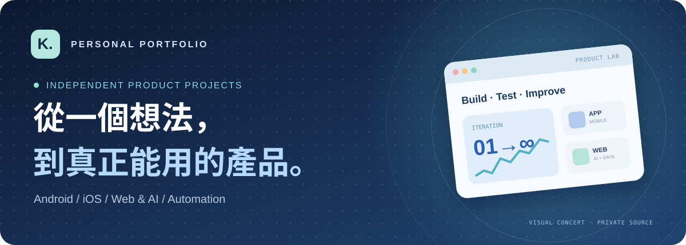
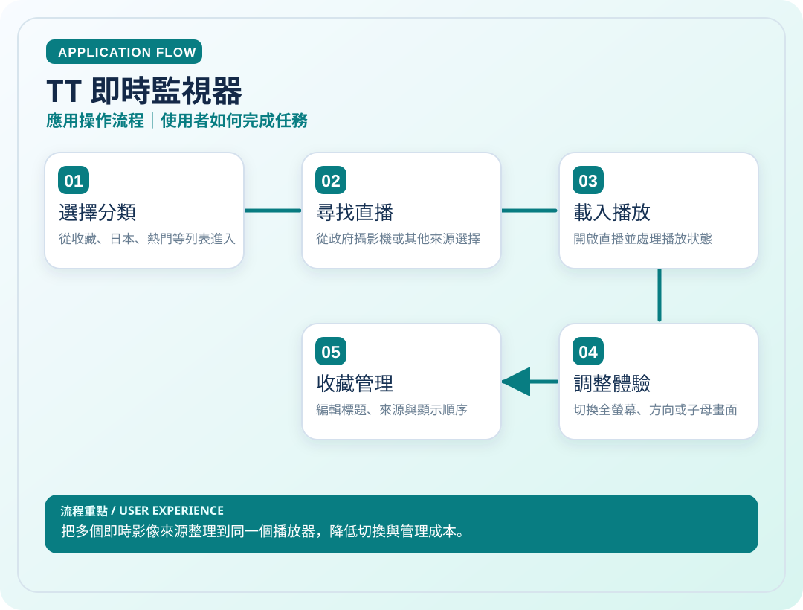
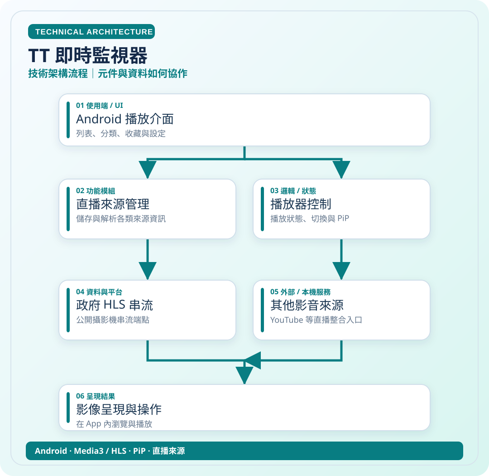
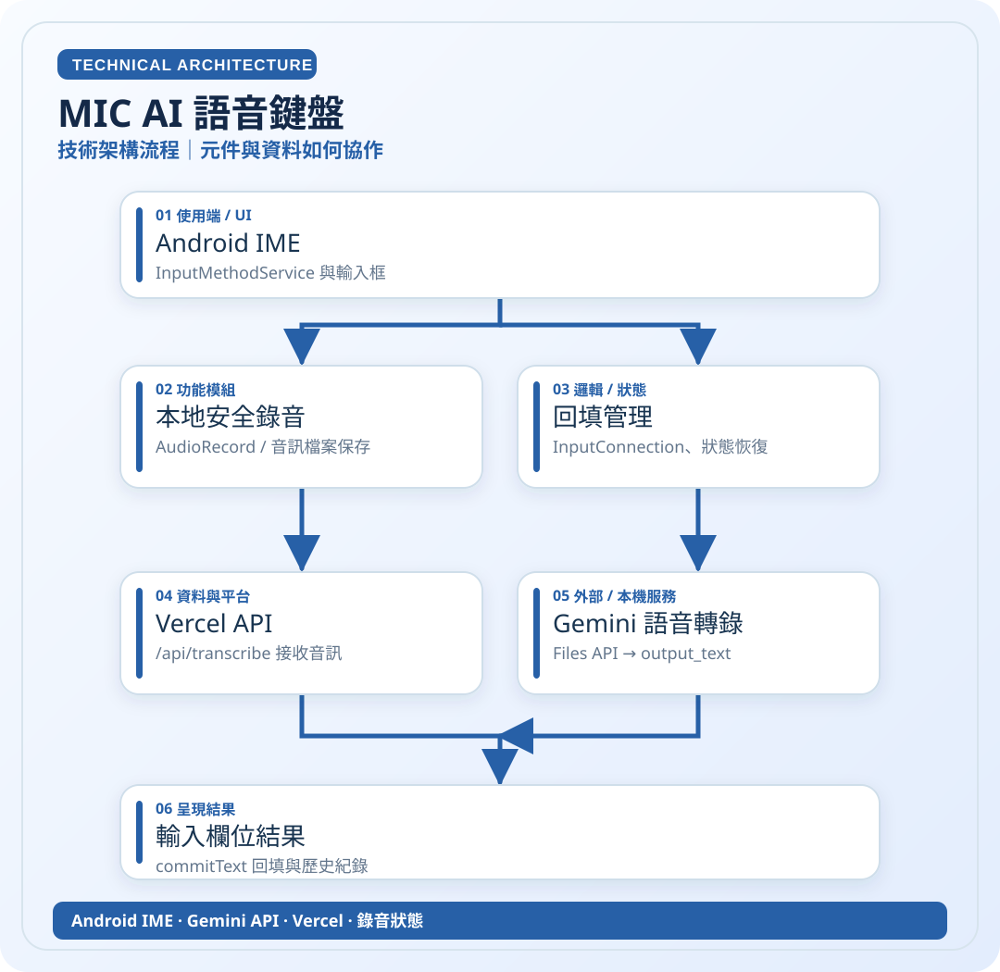
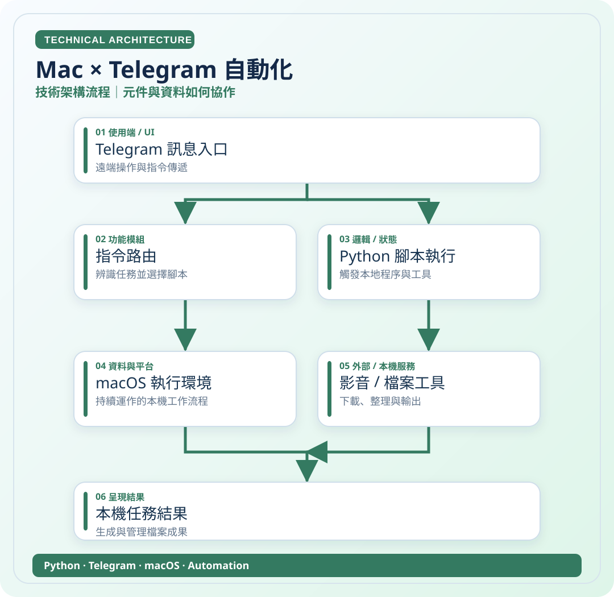
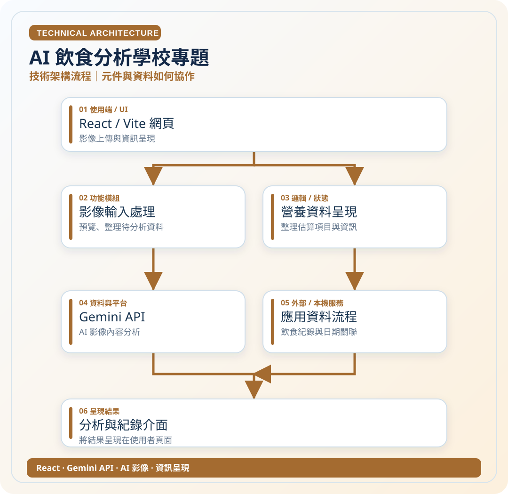

# 個人專案作品集｜雙視角流程圖

**先了解作品的用途與特色，再看應用流程與技術架構。** 我從實際需求發想，透過 AI 輔助開發與自主測試，嘗試將想法落實在 Android、iOS、網頁系統與 Mac 自動化工具。

> **給老師的導覽**：請點下方的**專案名稱**，在同一頁先看產品介紹，再往下直接看兩張流程圖。**不要點開 SVG 原始檔**，GitHub 可能顯示程式碼。

<table><tr><td align="center"><b>01 · 應用面</b> 使用者操作、功能與成果</td><td align="center"><b>02 · 技術面</b> 模組、系統、服務及資料流</td></tr><tr><td></td><td></td></tr></table>

## 精選作品（8 個）

- **[TT 即時監視器](docs/tt.md)**　把多個即時影像來源整理到同一個播放器，降低切換與管理成本。　[應用圖](assets/diagrams/tt-app.svg) · [技術圖](assets/diagrams/tt-tech.svg)
- **[MIC AI 語音鍵盤](docs/mic.md)**　把語音辨識直接放進輸入法，讓使用者不用切換 App 就能輸入文字。　[應用圖](assets/diagrams/mic-app.svg) · [技術圖](assets/diagrams/mic-tech.svg)
- **[MultiPane 多畫面影音](docs/multipane.md)**　一個畫面同時組合多個照片與影片區塊，並保留各自的操作方式。　[應用圖](assets/diagrams/multipane-app.svg) · [技術圖](assets/diagrams/multipane-tech.svg)
- **[KAICODE 程式碼閱讀器](docs/kaicode.md)**　在手機中瀏覽專案檔案、程式碼與 PDF，集中處理閱讀和搜尋。　[應用圖](assets/diagrams/kaicode-app.svg) · [技術圖](assets/diagrams/kaicode-tech.svg)
- **[KaiBlog 個人部落格](docs/kaiblog.md)**　從文章編輯延伸到會員權限、資料管理、互動留言與 AI 寫作輔助。　[應用圖](assets/diagrams/kaiblog-app.svg) · [技術圖](assets/diagrams/kaiblog-tech.svg)
- **[Mac × Telegram 自動化](docs/mac-auto.md)**　在外透過 Telegram 下達任務，讓 Mac 協助完成重複的檔案與影音作業。　[應用圖](assets/diagrams/mac-auto-app.svg) · [技術圖](assets/diagrams/mac-auto-tech.svg)
- **[AI 飲食分析學校專題](docs/food.md)**　將食物影像分析轉化為較容易理解與追蹤的飲食資訊。　[應用圖](assets/diagrams/food-app.svg) · [技術圖](assets/diagrams/food-tech.svg)
- **[Photo 私人相簿](docs/photo.md)**　規劃一套獨立於系統相簿的個人媒體空間，重視分類與隱私。　[應用圖](assets/diagrams/photo-app.svg) · [技術圖](assets/diagrams/photo-tech.svg)

## 其他個人專案（7 個）

- **[EQ 地震資訊工具](docs/eq.md)**　以地圖、震度與時間資訊呈現地震資料，減少使用者自行比對資料的負擔。　[應用圖](assets/diagrams/eq-app.svg) · [技術圖](assets/diagrams/eq-tech.svg)
- **[AM 本機音樂播放器](docs/am.md)**　聚焦離線音樂、長時間背景播放，以及減少操作步驟。　[應用圖](assets/diagrams/am-app.svg) · [技術圖](assets/diagrams/am-tech.svg)
- **[MP 浮動工具](docs/mp.md)**　把時間資訊與常用快捷操作留在其他 App 畫面上。　[應用圖](assets/diagrams/mp-app.svg) · [技術圖](assets/diagrams/mp-tech.svg)
- **[ST Telegram 快速分享](docs/st.md)**　從任何支援分享的 App，直接將資料存到 Telegram 我的收藏。　[應用圖](assets/diagrams/st-app.svg) · [技術圖](assets/diagrams/st-tech.svg)
- **[Pp 桌面邊緣角色](docs/pp.md)**　從自選圖片產生可調整的畫面邊緣角色，兼顧互動與不干擾操作。　[應用圖](assets/diagrams/pp-app.svg) · [技術圖](assets/diagrams/pp-tech.svg)
- **[Lunar 農曆日曆](docs/lunar.md)**　把日常需要的國曆、農曆資訊整合到簡潔的手機介面。　[應用圖](assets/diagrams/lunar-app.svg) · [技術圖](assets/diagrams/lunar-tech.svg)
- **[KPlayer 本機音樂](docs/kplayer.md)**　以 iOS 日常聆聽需求為中心，規劃本機音樂播放及操作流程。　[應用圖](assets/diagrams/kplayer-app.svg) · [技術圖](assets/diagrams/kplayer-tech.svg)

## 快速預覽：代表性圖解

<b>TT 即時監視器｜技術架構</b>

<b>MIC AI 語音鍵盤｜技術架構</b>

<b>Mac × Telegram｜技術架構</b>

<b>AI 飲食分析學校專題｜技術架構</b>

## 我的開發方式

需求觀察 → 功能規劃 → **ChatGPT / Codex 等 AI 輔助開發** → API / 資料整合 → 測試、除錯與反覆改善。

接觸領域包含 Android、SwiftUI、React、TypeScript、Python、Gemini API、Supabase、Vercel、GitHub 等；**並非宣稱每項技術皆已熟練**。

### 圖解說明與隱私

- 所有圖都是自製的**高層次流程／架構示意**，不是原始碼自動產生的逐函式呼叫圖。
- 有原始碼的專案，參考已能核對的 README 與功能資訊；**Mac、KPlayer、Lunar 等部分內容依個人描述整理**，各專案頁已標明。
- 功能涵蓋已實際使用、開發中與正在驗證的不同階段，**不把示意圖當作完整驗收證明**。
- 原本程式碼儲存庫仍為 **Private**。這個公開作品集沒有帳號密鑰、私人腳本或原始程式碼。

---

**閱讀方式**：點選上方任一專案名稱 → 先看「應用操作流程」→ 再看「技術架構流程」。SVG 圖可直接點開放大，適合電腦或手機閱讀。
