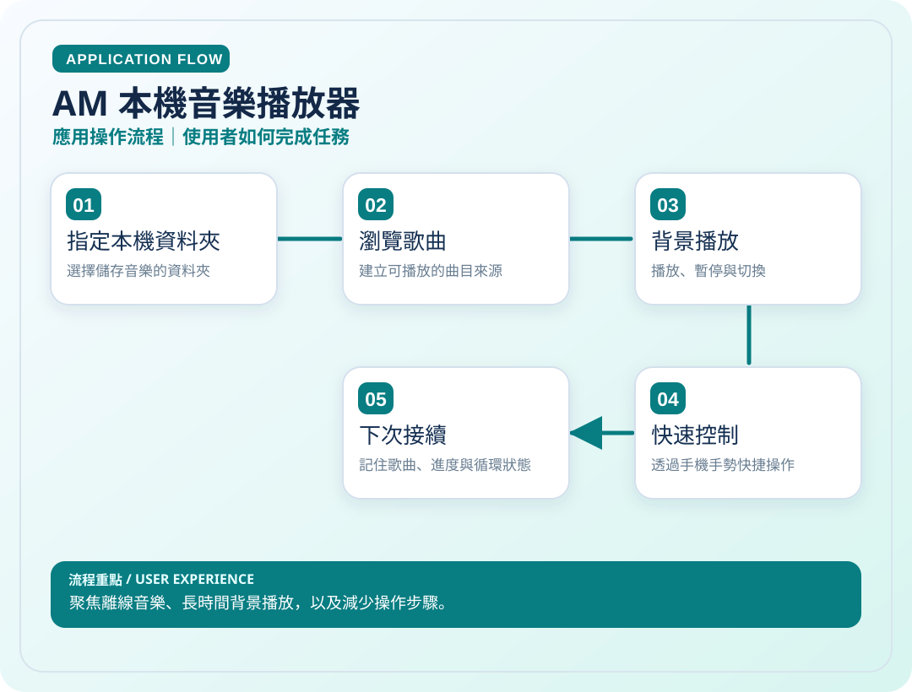
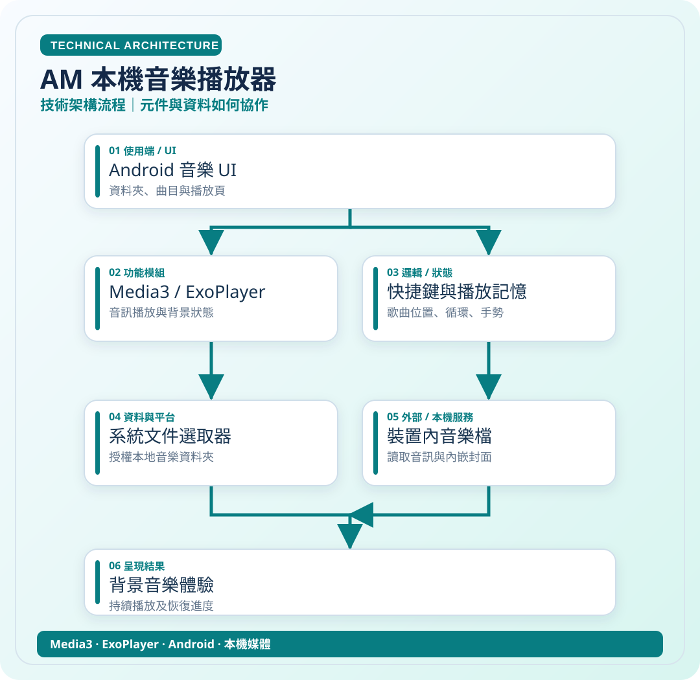

# AM 本機音樂播放器

> 聚焦離線音樂、長時間背景播放，以及減少操作步驟。

**領域**：Android　｜　**專案狀態**：個人工具

[← 回作品集首頁](../README.md)　·　[開啟應用圖 SVG](../assets/diagrams/am-app.svg)　·　[開啟技術圖 SVG](../assets/diagrams/am-tech.svg)

## 01｜應用操作流程

從使用者角度，看一次主要操作如何完成。

## 02｜技術架構流程

從資料、模組與服務的角度理解專案。這是**高層次架構示意**，不是自動產生的完整程式碼呼叫圖。

### 使用或接觸的技術

- Media3
- ExoPlayer
- Android
- 本機媒體

### 資料與驗證說明

依 AM README 中 Media3、音樂資料夾與快捷操作整理。 圖中只呈現代表性流程，不等同所有功能已完成或通過實機驗收。

原始碼儲存庫 `ownkaika/AM` 保持私人，不需公開給外部讀者。

---

[← 返回作品集目錄](../README.md)
