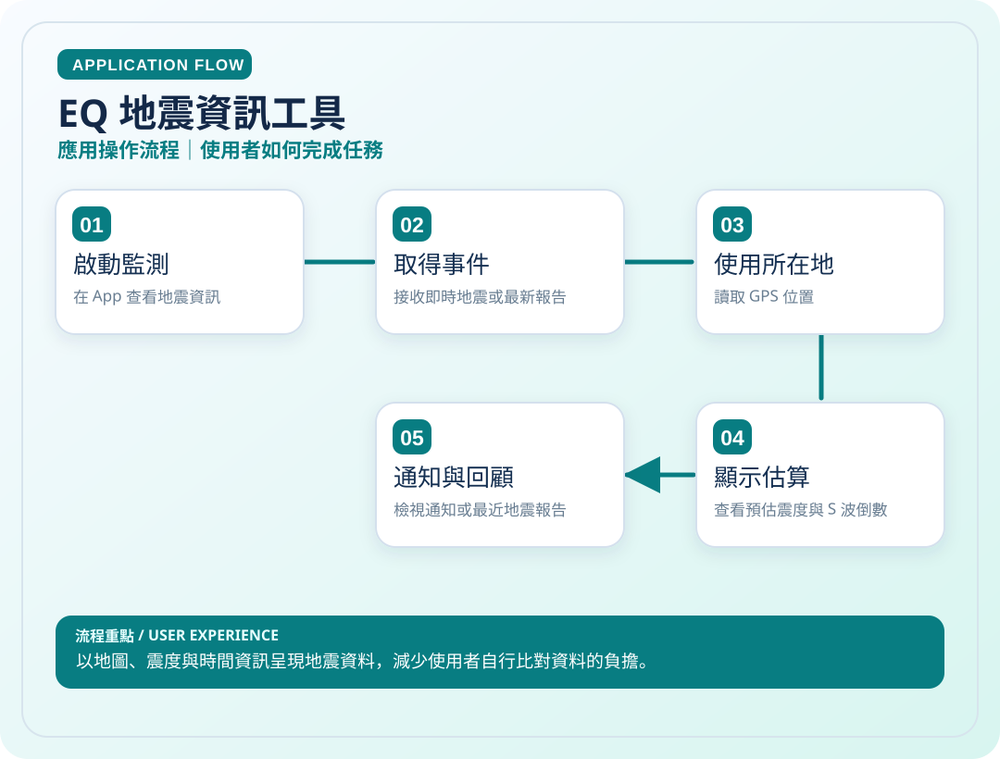
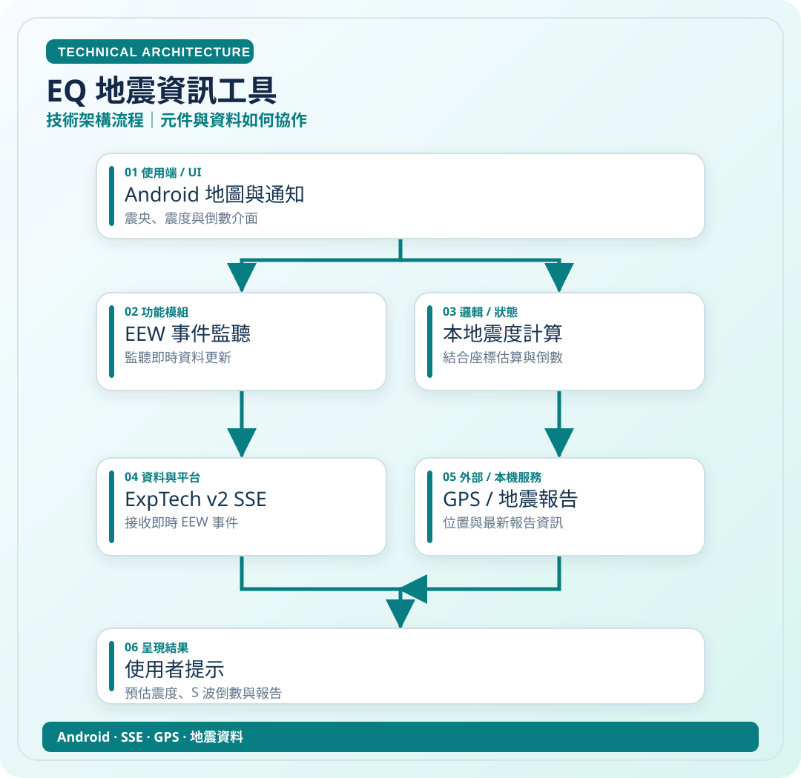

# EQ 地震資訊工具

> 以地圖、震度與時間資訊呈現地震資料，減少使用者自行比對資料的負擔。

**領域**：Android　｜　**專案狀態**：實驗與測試

[← 回作品集首頁](../README.md)　·　[開啟應用圖 SVG](../assets/diagrams/eq-app.svg)　·　[開啟技術圖 SVG](../assets/diagrams/eq-tech.svg)

## 這是什麼作品？

我希望地震資訊能一眼看懂，因此將震央、地圖、所在地估算震度與倒數集中在 Android 畫面中。

### 主要特色

即時地震事件、GPS 估算、S 波倒數、通知；不取代官方警報。

> 兩張流程圖直接顯示在下方，不用開啟 SVG 原始碼。

## 01｜應用操作流程

從使用者角度，看一次主要操作如何完成。

## 02｜技術架構流程

從資料、模組與服務的角度理解專案。這是**高層次架構示意**，不是自動產生的完整程式碼呼叫圖。

### 使用或接觸的技術

- Android
- SSE
- GPS
- 地震資料

### 資料與驗證說明

依 EQ README 中的 SSE、GPS 與 S 波倒數資訊整理；不取代官方警報。 圖中只呈現代表性流程，不等同所有功能已完成或通過實機驗收。

原始碼儲存庫 `ownkaika/EQ` 保持私人，不需公開給外部讀者。

---

[← 返回作品集目錄](../README.md)
