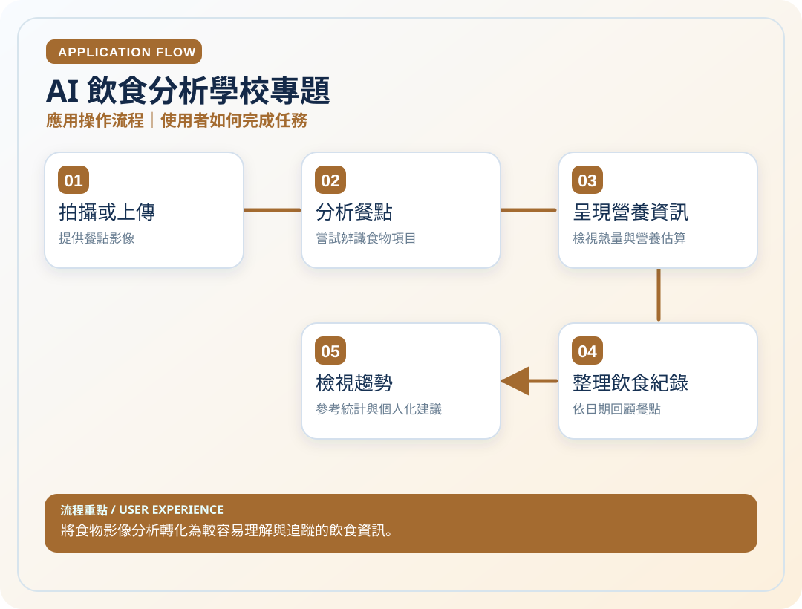
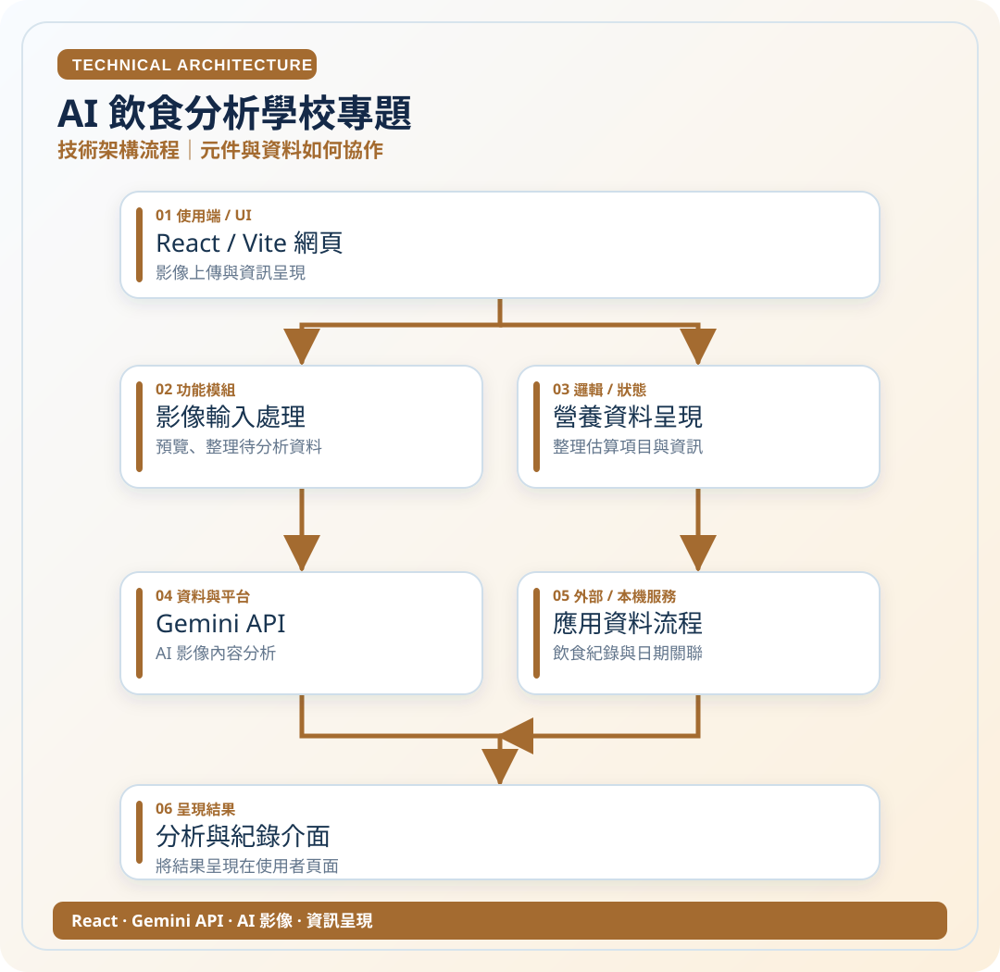

# 智慧飲食紀錄與營養分析建議系統

**類型：** 網站／AI　　**性質：** 朝陽科技大學四人團隊專題  
**重點：** Gemini 食物辨識、飲食日曆、營養資訊呈現

## 為什麼做

傳統飲食紀錄常要自己查詢食物、估算熱量，再逐筆輸入。我們希望先讓使用者拍攝餐點，就能取得可閱讀的營養估算，再把結果留下來做日常追蹤。

## 使用者怎麼操作

1. 在手機或電腦登入，設定基本身體資料。
2. 拍照或上傳餐點，透過 **Gemini API** 輔助辨識食物種類、估算熱量。
3. 查看當次的分析資訊，以及個人化的每日熱量需求參考。
4. 把資料保存到**飲食日曆**，日後可依日期查看、補記餐點，並瀏覽營養統計與隔日飲食建議。

對我來說，單次 AI 分析不是結束；**讓使用者下次能找回紀錄、看懂變化**，才是能長期使用的關鍵。

## 我在四人團隊中的參與

- **資料與服務串接**：參與後端 API、資料庫及其他服務整合，與前端組員協調分析資料如何儲存、查詢與顯示。
- **日曆功能與介面**：參與日期切換、歷史紀錄、補記餐點等操作與畫面設計。
- **功能測試**：協助確認從上傳照片、取得分析，到日曆保存及再次查看的流程；注意例外情況和資訊呈現方式。

以上是我的參與內容；整套系統由四人共同完成，不把其他組員負責的部分算成個人工作。

## 技術與使用限制

團隊使用 React、TypeScript、Node.js、Gemini API、Firebase、Supabase 及 Vercel。AI 對食物種類和熱量的判斷屬**估算**，不等於實際測量，也不能代替營養師或醫療建議。

查看操作流程與技術架構示意

[回作品集首頁](../README.md)
