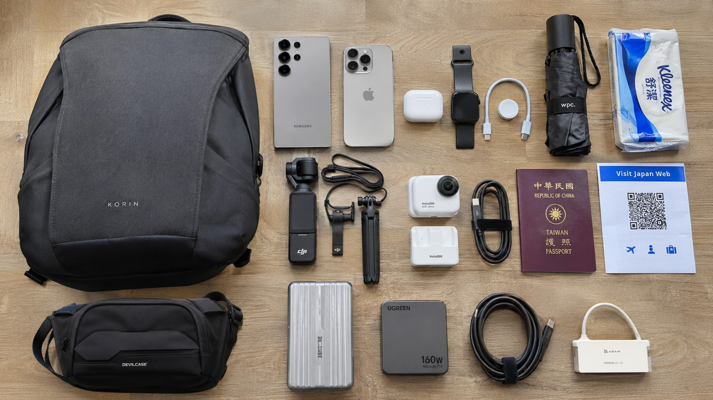
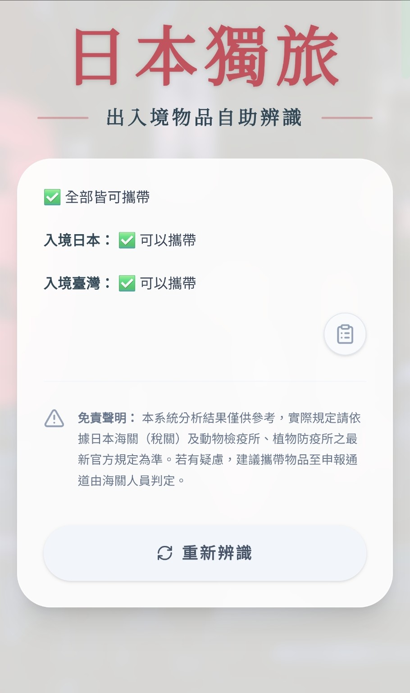

# 臺日海關行李 AI 自助檢查（JPNT）

**類型：** 網站／AI　　**性質：** 個人自主專案  
**網站：** [jpnt.vercel.app](https://jpnt.vercel.app/)

## 為什麼做

出國前整理行李，常會遇到「這個東西到底能不能帶？」的問題。若逐項搜尋資料，還要分別核對入境臺灣或日本的規定，流程相當零碎。我希望先讓使用者用最直接的方式輸入物品，再得到容易閱讀的初步整理。

## 使用者怎麼操作

1. **輸入物品名稱**，或**上傳照片／直接拍照**；不必自己先把每樣物品寫成完整清單。
2. 系統使用 Gemini 辨識輸入內容與圖片中的物品。
3. 分別整理**入境日本、入境臺灣**可能受到限制或需要留意的項目。
4. 將結果依風險與方向整理成容易掃讀的內容，減少使用者自行交叉比對的時間。

## 實際畫面｜一張照片到辨識結果

**① 輸入：上傳行李照片**（示範用的物品排列照）

**② 輸出：查看 AI 辨識結果**

**操作重點：** 使用者不用逐件打字，直接提供物品照片，就能查看系統整理的臺日攜帶判斷。圖中「全部皆可攜帶」是**這次示範的 AI 輸出**，不代表官方通關保證。

## 這個產品的設計重點

不是把大量規定原封不動放在畫面上，而是讓使用者先看見**哪幾項物品值得再確認**。文字輸入、上傳照片、相機拍攝三種入口，對應不同的行李準備情況。

## 我做了什麼、仍有哪些限制

由我規劃操作方式、辨識輸入、結果分類與頁面呈現，運用 AI 輔助開發 React／TypeScript 網頁並串接 Gemini API。系統設有使用提醒，避免將模型輸出當成官方核准。

**重要限制：** 這是 AI 輔助的初步判斷工具，不是海關即時法規資料庫。模型可能辨識錯物品，也可能未掌握最新規定。實際攜帶限制必須再次查閱臺灣與日本海關、動植物檢疫等主管機關公告。

[回作品集首頁](../README.md)
