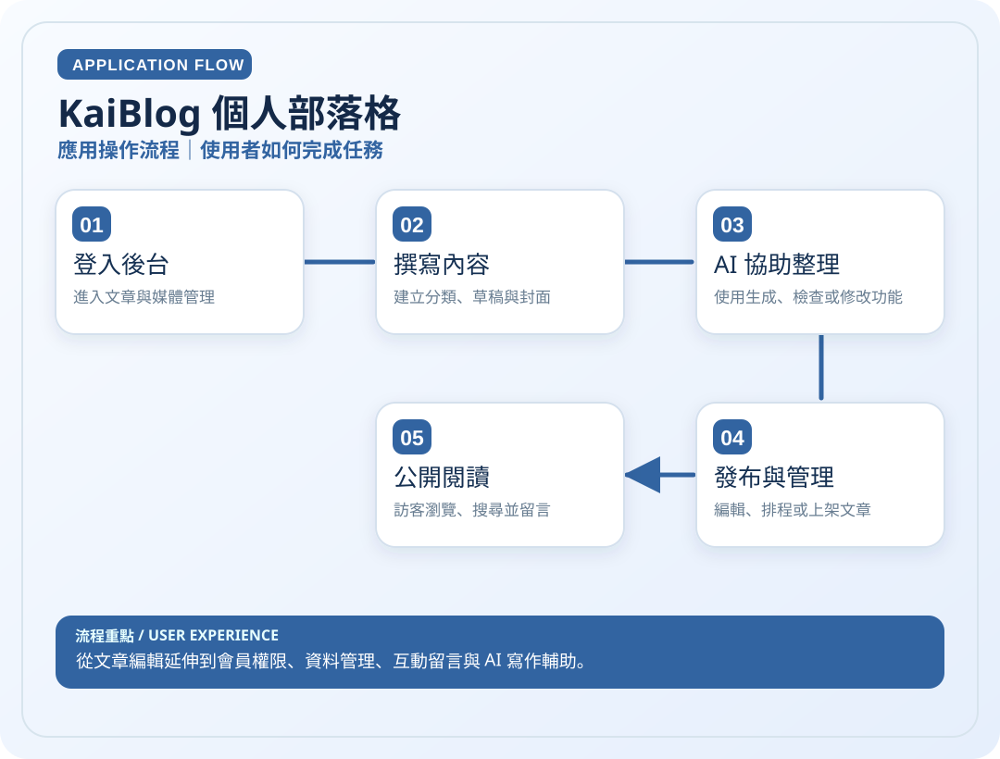
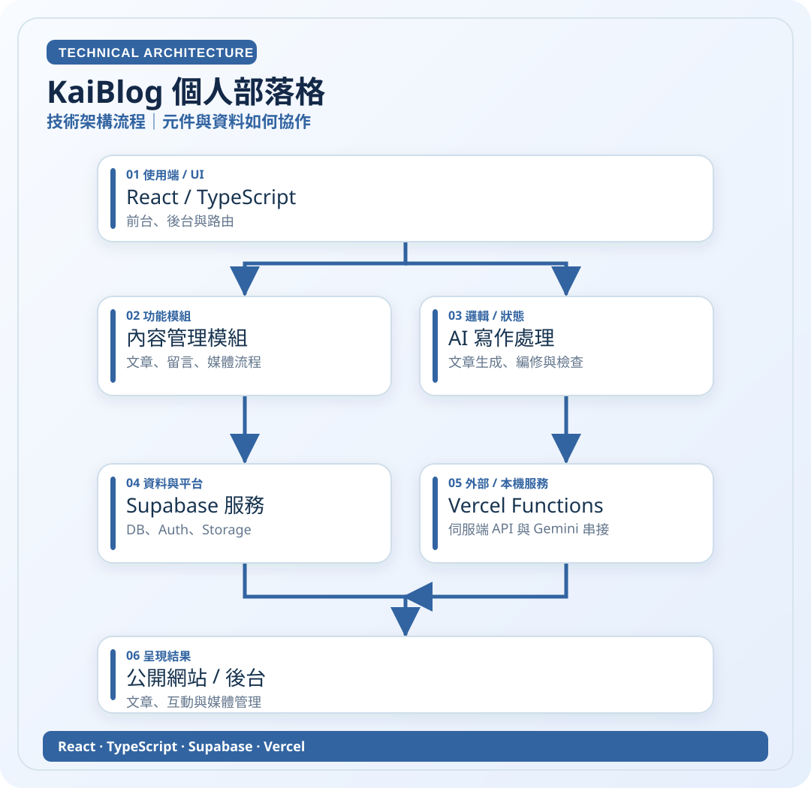

# KaiBlog｜個人文章與內容管理網站

**類型：** 網站／AI　　**性質：** 個人自主專案、持續改善  
**網站：** [kaiblogs.vercel.app](https://kaiblogs.vercel.app/)

## 為什麼做

我想要一個自己能長期使用的內容空間：正式文章可以慢慢整理，日常短貼文則可以快速記錄，而不是把所有內容混在同一種頁面。更重要的是，我希望能自己設計從撰寫、保存到發布與維護的整個流程。

## 使用者看到什麼

- **一般文章與日常貼文分開呈現**：讀者可以看較完整的文章，也可以瀏覽短篇生活記錄。
- **容易找到舊內容**：文章支援分類、標籤、搜尋及依月份查看封存內容。
- **留言互動**：設有文章留言與網站留言板；公開頁面以閱讀為主。

## 我設計的管理後台

這是我投入最多規劃的部分。網站不是只有一個可以輸入文章的編輯器，而是把日常管理工作放進同一個後台：

1. **文章管理**：新增、編輯、預覽、草稿保存、排程發布、置頂與封存。
2. **日常貼文**：可另外新增及管理圖文短貼文，不必套用長篇文章格式。
3. **圖片與留言**：媒體庫、留言審核、回收桶及內容還原，減少誤刪造成的影響。
4. **管理權限**：管理員登入後才能管理內容；訪客則使用公開閱讀與留言功能。

## AI 功能如何協助寫作

- **產生文章**：輸入主題，或用語音提供想法，讓 Gemini 協助整理成可再編修的文章。
- **編修與查核**：針對既有文章提出修改要求，並搭配 Google 搜尋檢查需要查證的內容；AI 結果仍由使用者確認。
- **多語翻譯**：以繁體中文文章為來源，產生英文與日文版本；文章有更新時，系統會辨識翻譯是否需要重做。

我希望 AI 是編輯工具，不是替使用者直接決定要發布什麼。因此流程仍保留人工預覽、修改與確認。

## 參與與技術

這是我的個人專案，由我規劃網站用途、前後台功能、操作流程及測試方式；實作過程使用 AI 輔助程式開發與除錯。接觸 React、TypeScript、Supabase（資料、登入、儲存）、Vercel 和 Gemini API。

**目前狀態：** 已建立前台及管理後台的主要功能，仍會依使用經驗調整；AI 產生與翻譯功能需有正常的外部服務與設定，結果不保證每次都正確。網站主要是個人內容管理工具，不是多人協作平台。

查看操作流程與技術架構示意

[回作品集首頁](../README.md)
