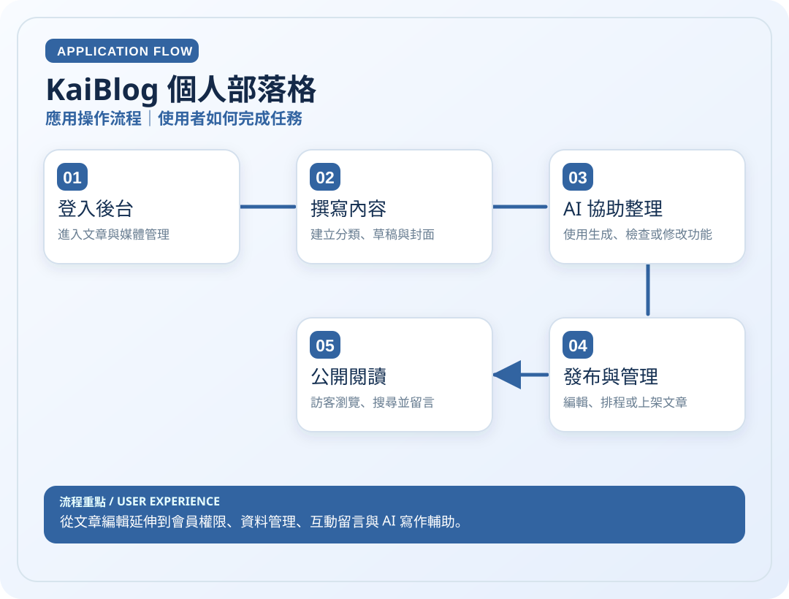
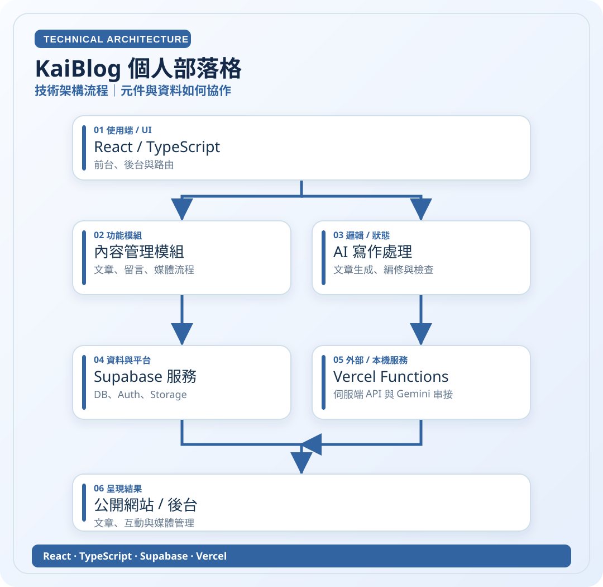

# KaiBlog 個人部落格

> 從文章編輯延伸到會員權限、資料管理、互動留言與 AI 寫作輔助。

**領域**：Web　｜　**專案狀態**：持續改善

[← 回作品集首頁](../README.md)　·　[開啟應用圖 SVG](../assets/diagrams/kaiblog-app.svg)　·　[開啟技術圖 SVG](../assets/diagrams/kaiblog-tech.svg)

## 01｜應用操作流程

從使用者角度，看一次主要操作如何完成。

## 02｜技術架構流程

從資料、模組與服務的角度理解專案。這是**高層次架構示意**，不是自動產生的完整程式碼呼叫圖。

### 使用或接觸的技術

- React
- TypeScript
- Supabase
- Vercel

### 資料與驗證說明

依 Blog README 所列技術架構及功能整理。 圖中只呈現代表性流程，不等同所有功能已完成或通過實機驗收。

原始碼儲存庫 `ownkaika/Blog` 保持私人，不需公開給外部讀者。

---

[← 返回作品集目錄](../README.md)
