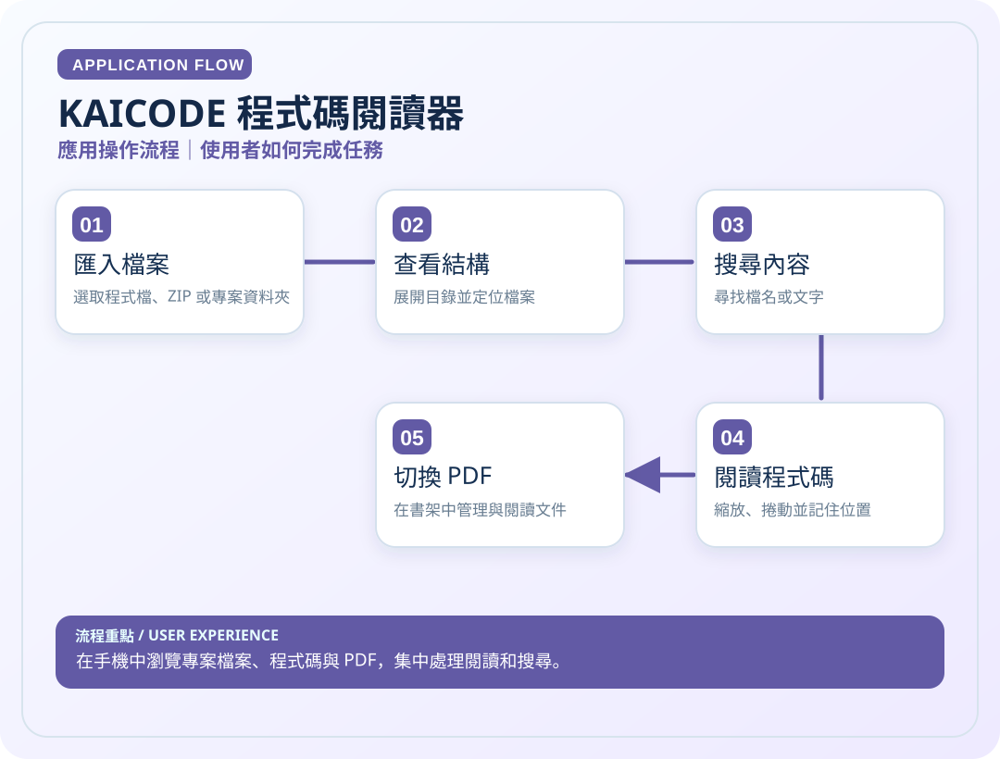
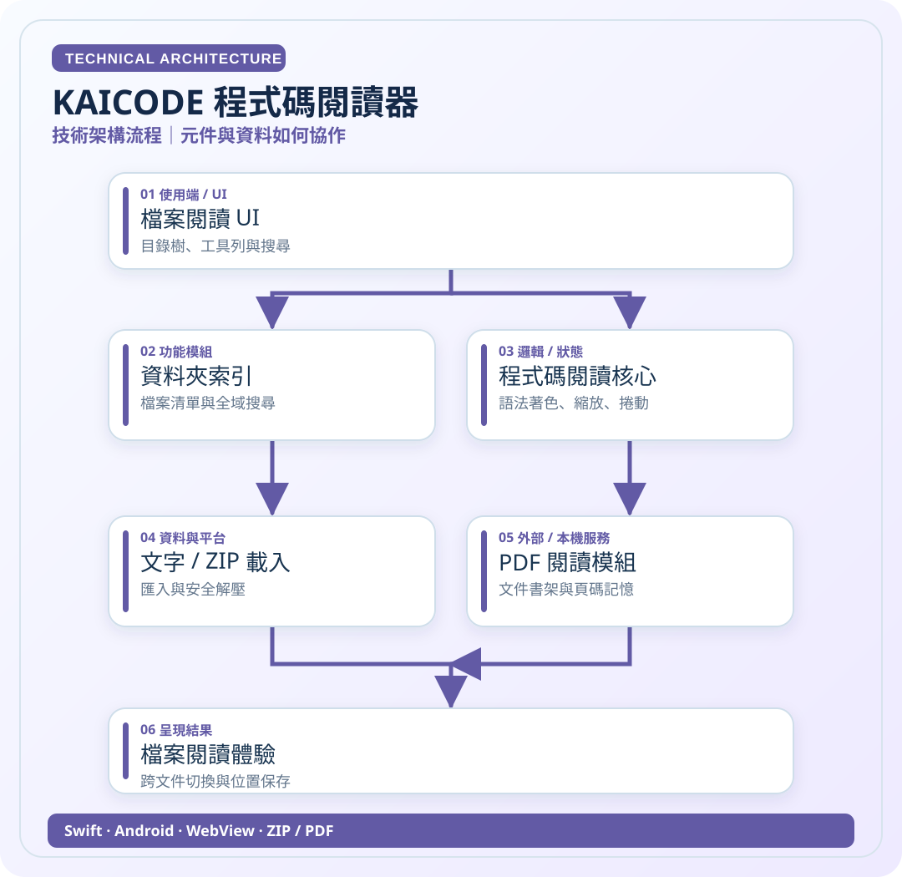

# KAICODE 程式碼閱讀器

> 在手機中瀏覽專案檔案、程式碼與 PDF，集中處理閱讀和搜尋。

**領域**：iOS / Android　｜　**專案狀態**：持續移植

[← 回作品集首頁](../README.md)　·　[開啟應用圖 SVG](../assets/diagrams/kaicode-app.svg)　·　[開啟技術圖 SVG](../assets/diagrams/kaicode-tech.svg)

## 01｜應用操作流程

從使用者角度，看一次主要操作如何完成。

## 02｜技術架構流程

從資料、模組與服務的角度理解專案。這是**高層次架構示意**，不是自動產生的完整程式碼呼叫圖。

### 使用或接觸的技術

- Swift
- Android
- WebView
- ZIP / PDF

### 資料與驗證說明

依 KC Android 移植 README、iOS 作品描述整理。 圖中只呈現代表性流程，不等同所有功能已完成或通過實機驗收。

原始碼儲存庫 `ownkaika/KC` 保持私人，不需公開給外部讀者。

---

[← 返回作品集目錄](../README.md)
