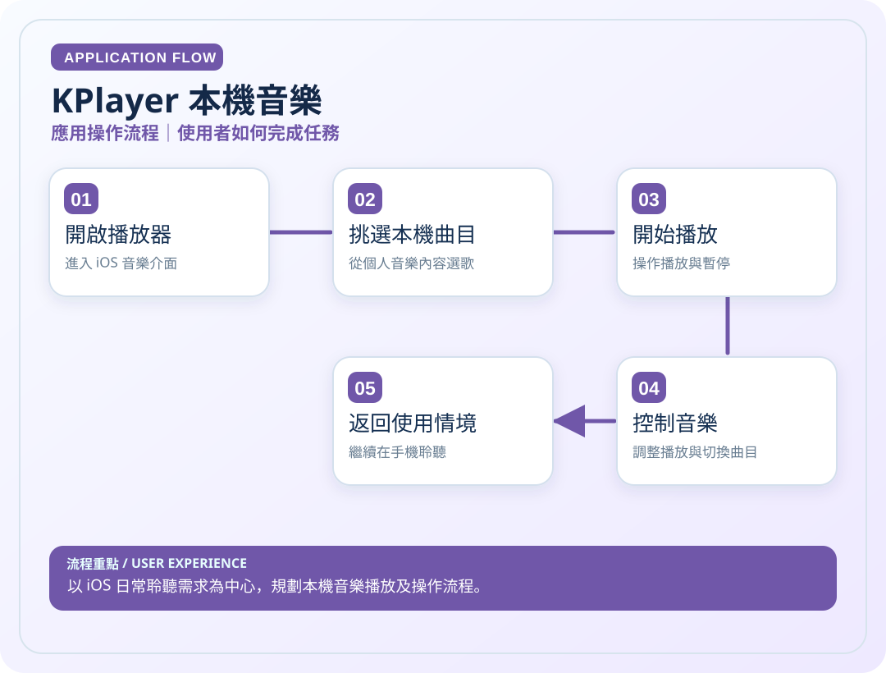
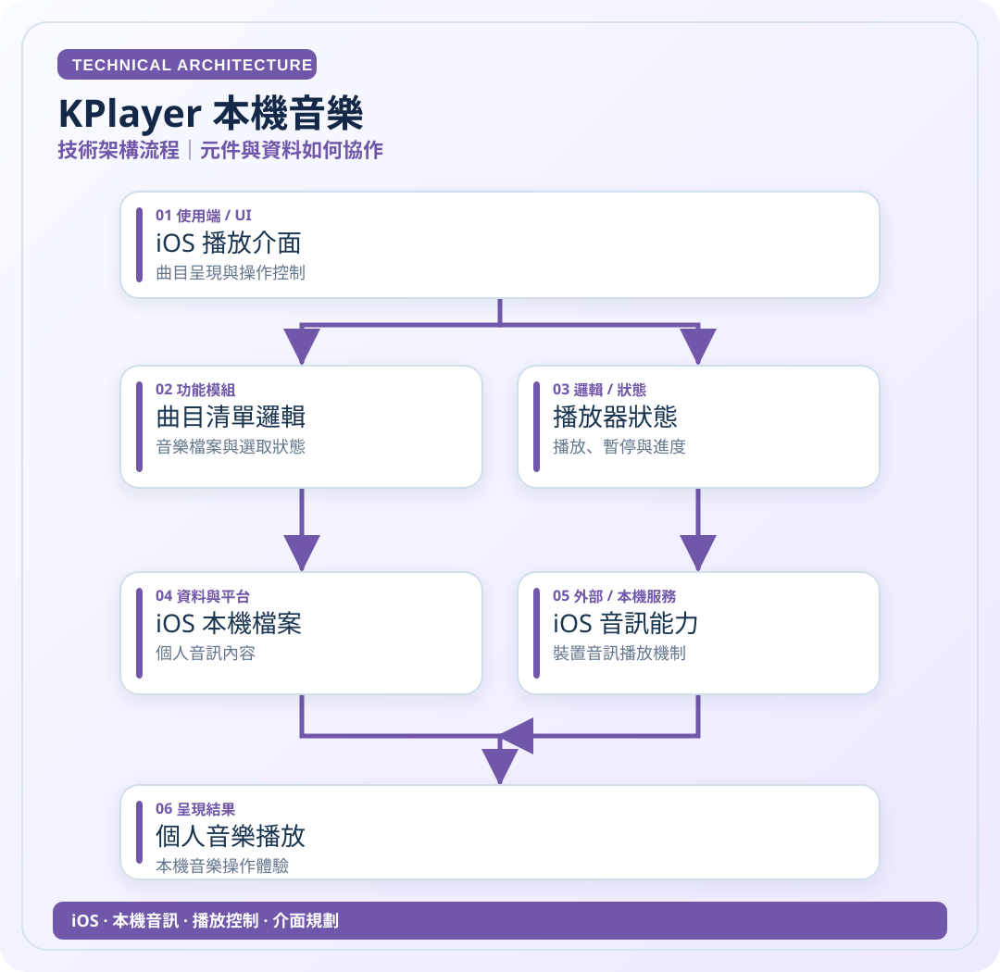

# KPlayer 本機音樂

> 以 iOS 日常聆聽需求為中心，規劃本機音樂播放及操作流程。

**領域**：iOS　｜　**專案狀態**：個人作品

[← 回作品集首頁](../README.md)

## 這是什麼作品？

KPlayer 是依照我在 iPhone 上的日常聆聽方式設計的本機音樂工具。我希望不用依賴線上串流曲庫，也能直覺地瀏覽手機裡的音樂並控制播放。

### 主要特色與使用情境

本機曲目瀏覽、播放、暫停與切換，專注於簡潔的 iOS 操作流程。

### 技術重點

本機音訊與播放控制的高層次規劃；未核對的底層播放框架不列為已證實技術。

> **看圖提示**：下方兩張圖已直接顯示在本頁，無須點開 SVG 原始碼。

## 01｜應用操作流程

從使用者角度，看一次主要操作如何完成。

## 02｜技術架構流程

從資料、模組與服務的角度理解專案。這是**高層次架構示意**，不是自動產生的完整程式碼呼叫圖。

### 使用或接觸的技術

- iOS
- 本機音訊
- 播放控制
- 介面規劃

### 資料與驗證說明

依個人 iOS 作品描述整理；未查驗原始碼與底層播放框架。 圖中只呈現代表性流程，不等同所有功能已完成或通過實機驗收。

---

[← 返回作品集目錄](../README.md)
