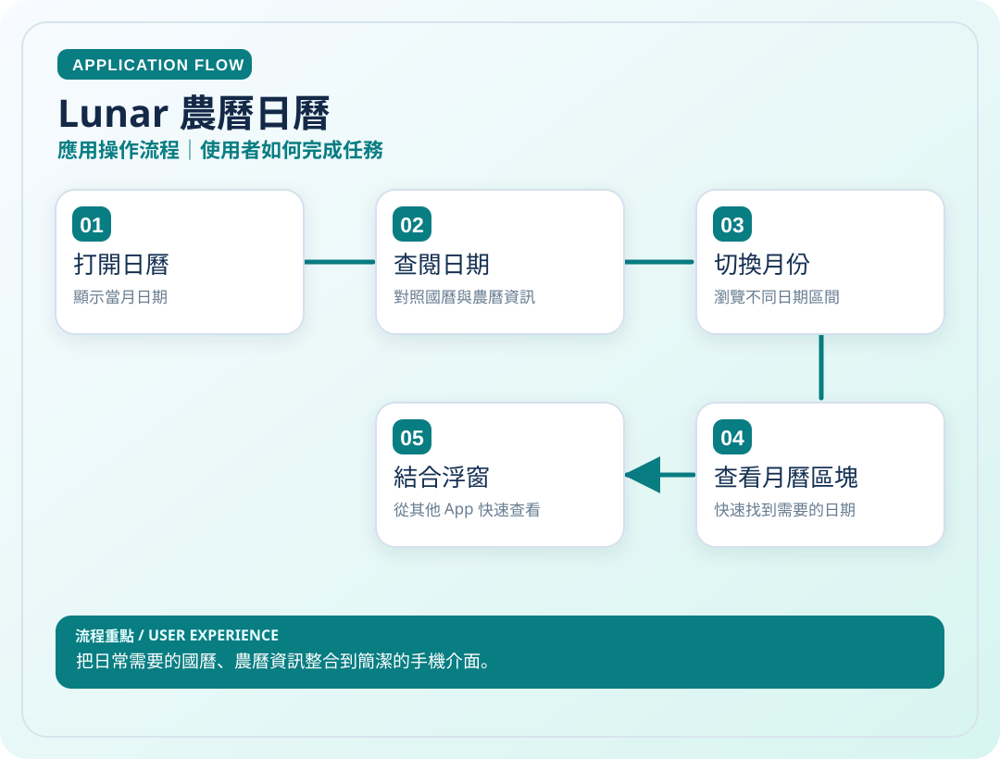
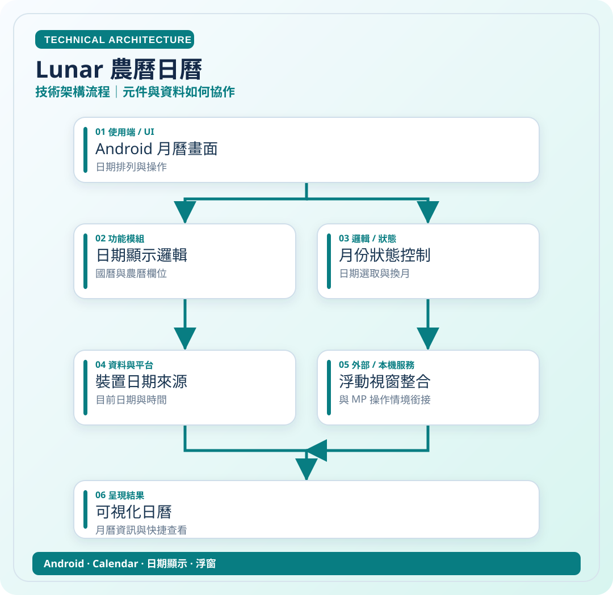

# Lunar 農曆日曆

> 把日常需要的國曆、農曆資訊整合到簡潔的手機介面。

**領域**：Android　｜　**專案狀態**：個人工具

[← 回作品集首頁](../README.md)

## 這是什麼作品？

Lunar 是我為日常快速對照國曆、農曆而設計的 Android 日曆工具。它重視簡潔、易讀，希望一打開就能看懂日期，也探索將月曆直接放到浮動工具的使用情境。

### 主要特色與使用情境

國農曆月曆、月份切換與 MP 浮動視窗整合構想；部分功能仍屬規劃。

### 技術重點

日期資料處理、月曆介面與 Android 浮動視窗整合。

> **看圖提示**：下方兩張圖已直接顯示在本頁，無須點開 SVG 原始碼。

## 01｜應用操作流程

從使用者角度，看一次主要操作如何完成。

## 02｜技術架構流程

從資料、模組與服務的角度理解專案。這是**高層次架構示意**，不是自動產生的完整程式碼呼叫圖。

### 使用或接觸的技術

- Android
- Calendar
- 日期顯示
- 浮窗

### 資料與驗證說明

依個人對 Lunar 與 MP 整合的描述整理；技術模組為高層次示意。 圖中只呈現代表性流程，不等同所有功能已完成或通過實機驗收。

原始碼儲存庫 `ownkaika/Lunar` 保持私人，不需公開給外部讀者。

---

[← 返回作品集目錄](../README.md)
