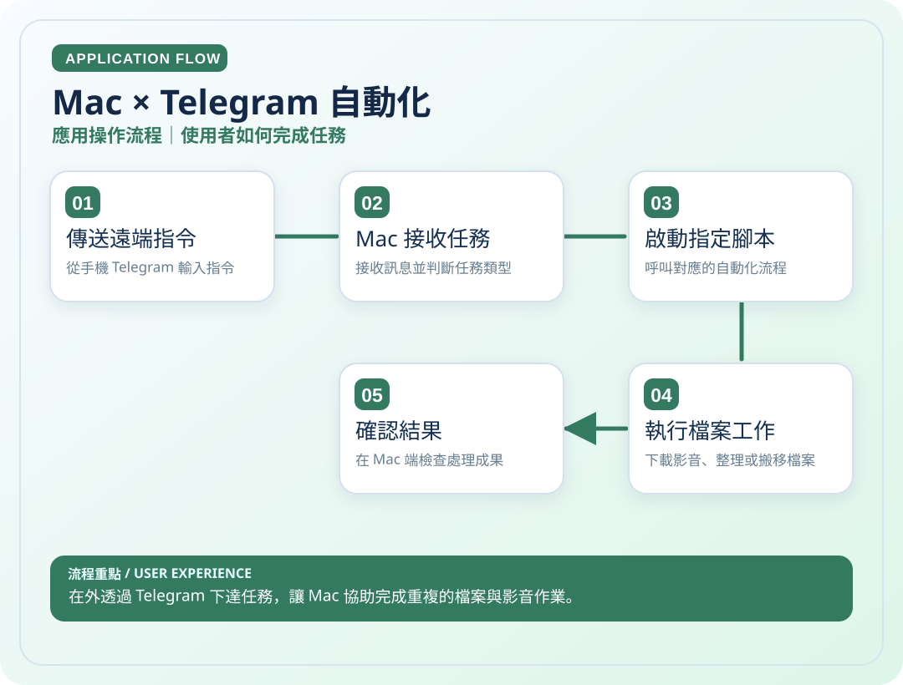

# Mac × Telegram 自動化

> 在外透過 Telegram 下達任務，讓 Mac 協助完成重複的檔案與影音作業。

**領域**：Automation　｜　**專案狀態**：本機長期使用

[← 回作品集首頁](../README.md)

## 這是什麼作品？

這是我為自己的 Mac 建立的遠端自動化工具。當人不在電腦前，仍希望處理社群影音下載、檔案整理等重複工作時，可以透過手機的 Telegram 發送指令，讓 Mac 自動執行本機 Python 腳本。

### 主要特色與使用情境

Telegram 遠端操作、任務執行、影音下載和檔案管理，主要滿足個人長期使用需求；本機原始腳本未公開。

### 技術重點

Telegram 訊息與指令解析、Python 任務路由、macOS 本機程序及檔案處理。

> **看圖提示**：下方兩張圖會直接顯示在本頁，不需要點開 SVG 原始檔。

## 01｜應用操作流程

從使用者角度，看一次主要操作如何完成。

## 02｜技術架構流程

從資料、模組與服務的角度理解專案。這是**高層次架構示意**，不是自動產生的完整程式碼呼叫圖。

### 使用或接觸的技術

- Python
- Telegram
- macOS
- Automation

### 資料與驗證說明

依個人描述的 Mac 本機腳本整理；未讀取私人腳本原始碼。 圖中只呈現代表性流程，不等同所有功能已完成或通過實機驗收。

---

[← 返回作品集目錄](../README.md)
