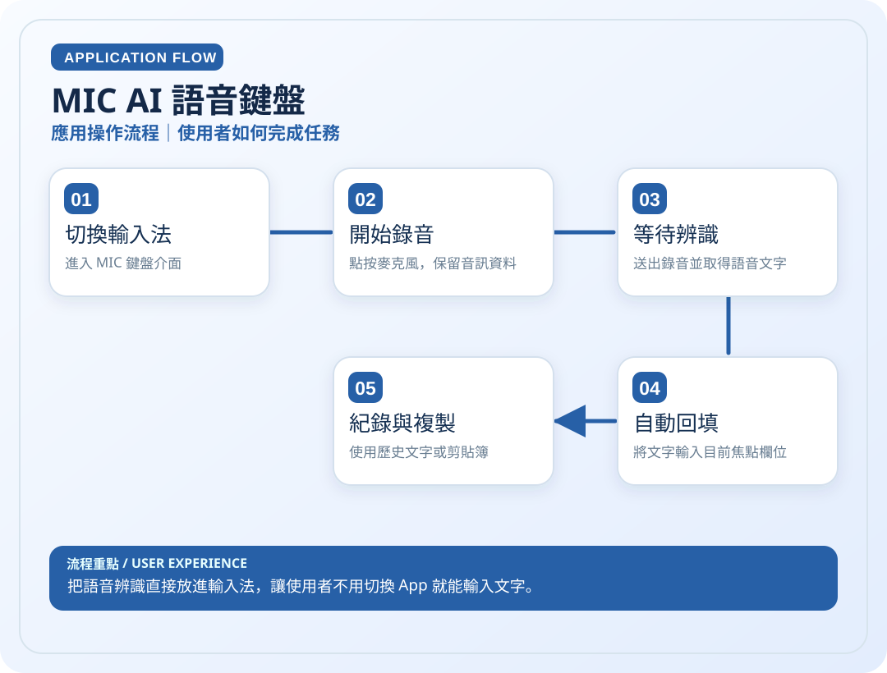
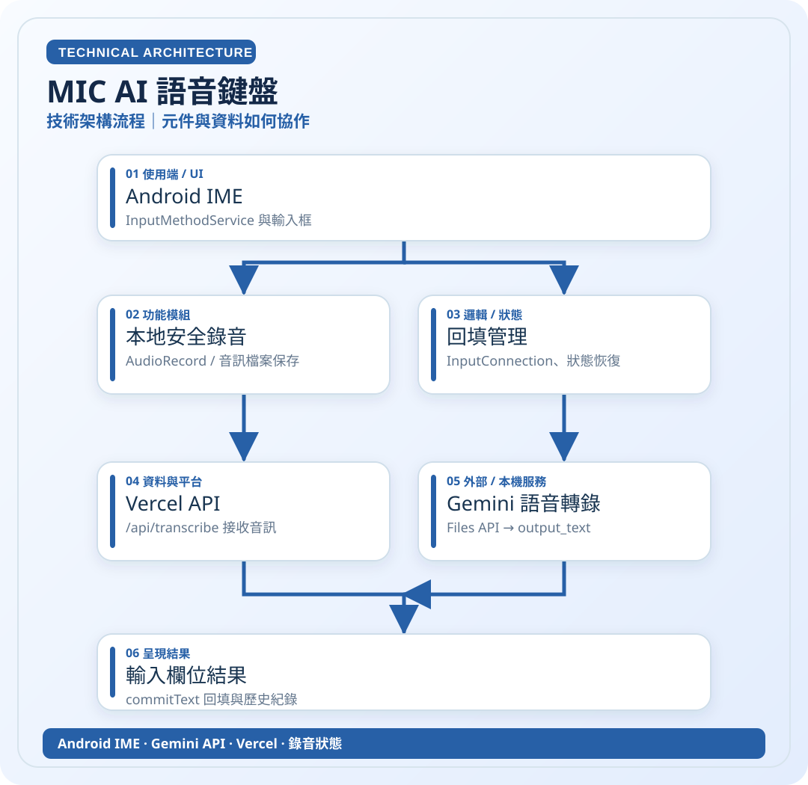

# AI 語音鍵盤｜Android

**類型：** Android App／AI　　**性質：** 個人自主專案、持續改善

## 為什麼做

在手機聊天、搜尋或寫筆記時，如果想直接用說話輸入文字，不應該還要先打開錄音 App、取得文字，再複製貼上。我想把這個流程縮短到手機原本的輸入框裡。

## 實際使用流程

1. 切換到 AI 語音鍵盤，按下麥克風開始說話。
2. 停止錄音後，音訊經由後端服務送往 **Gemini 語音辨識**。
3. 取得文字，嘗試直接填入使用者當下的聊天或搜尋輸入框。
4. 如果需要重聽或重新轉錄，可回到錄音歷史紀錄處理。

鍵盤也規劃了常用文字與剪貼簿入口，減少反覆切換工具。

## 我特別處理的問題

**錄音不能因為辨識失敗就消失。** 因此錄音從開始就寫入手機本機檔案，遇到中斷、網路失敗或需要重試時，仍能從歷史資料恢復與重新轉錄。

另一個問題是不同 App 的輸入框行為不完全相同：切換 App、回到原本游標位置、背景處理完成後回填文字，都需要不斷在實機測試。這些相容性問題仍持續改善，不能保證每個輸入框都一次成功。

## 參與與技術

由我規劃使用情境、鍵盤操作、錄音保存與錯誤恢復流程，透過 AI 輔助實作與實機驗證。接觸 Android IME／InputConnection、本機錄音儲存、Vercel API 與 Gemini 語音辨識服務。

查看操作流程與技術架構示意

[回作品集首頁](../README.md)
