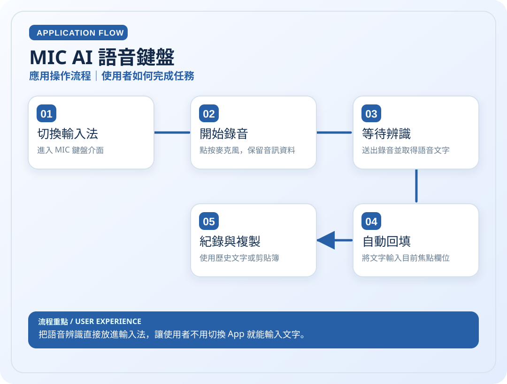

# MIC AI 語音鍵盤

> 把語音辨識直接放進輸入法，讓使用者不用切換 App 就能輸入文字。

**領域**：Android / AI　｜　**專案狀態**：持續改善

[← 回作品集首頁](../README.md)

## 這是什麼作品？

MIC 是我為經常需要在手機上輸入文字、希望用說話代替打字的人設計的 Android AI 語音鍵盤。它直接整合在系統輸入法中，使用者在聊天、搜尋或筆記時，不必跳到其他 App 錄音再複製文字。

### 主要特色

按下鍵盤麥克風錄音，交由 AI 轉成文字，再嘗試回填到正在使用的輸入框；另提供複製、刪除等快捷操作。文字回填仍在持續改善，不能視為每次都成功。

### 技術重點

Android IME 與 InputConnection 負責鍵盤及輸入欄位互動；語音經 API 送往 Gemini 辨識，再將結果回傳到輸入法。

> **看圖提示**：下方應用圖與技術圖會直接顯示在本頁，無須開啟 SVG 檔案。

## 01｜應用操作流程

從使用者角度，看一次主要操作如何完成。

## 02｜技術架構流程

從資料、模組與服務的角度理解專案。這是**高層次架構示意**，不是自動產生的完整程式碼呼叫圖。

### 使用或接觸的技術

- Android IME
- Gemini API
- Vercel
- 錄音狀態

### 資料與驗證說明

依 Mic README 中的轉錄路徑、IME 與回填實作整理。 圖中只呈現代表性流程，不等同所有功能已完成或通過實機驗收。

原始碼儲存庫 `ownkaika/Mic` 保持私人，不需公開給外部讀者。

---

[← 返回作品集目錄](../README.md)
