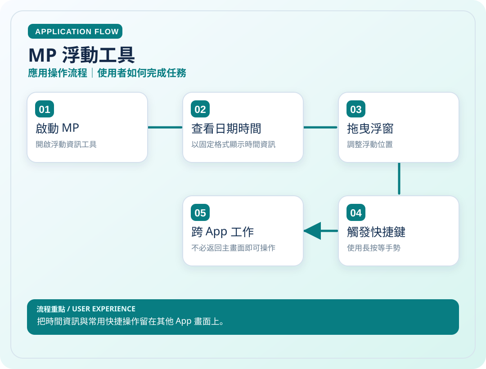
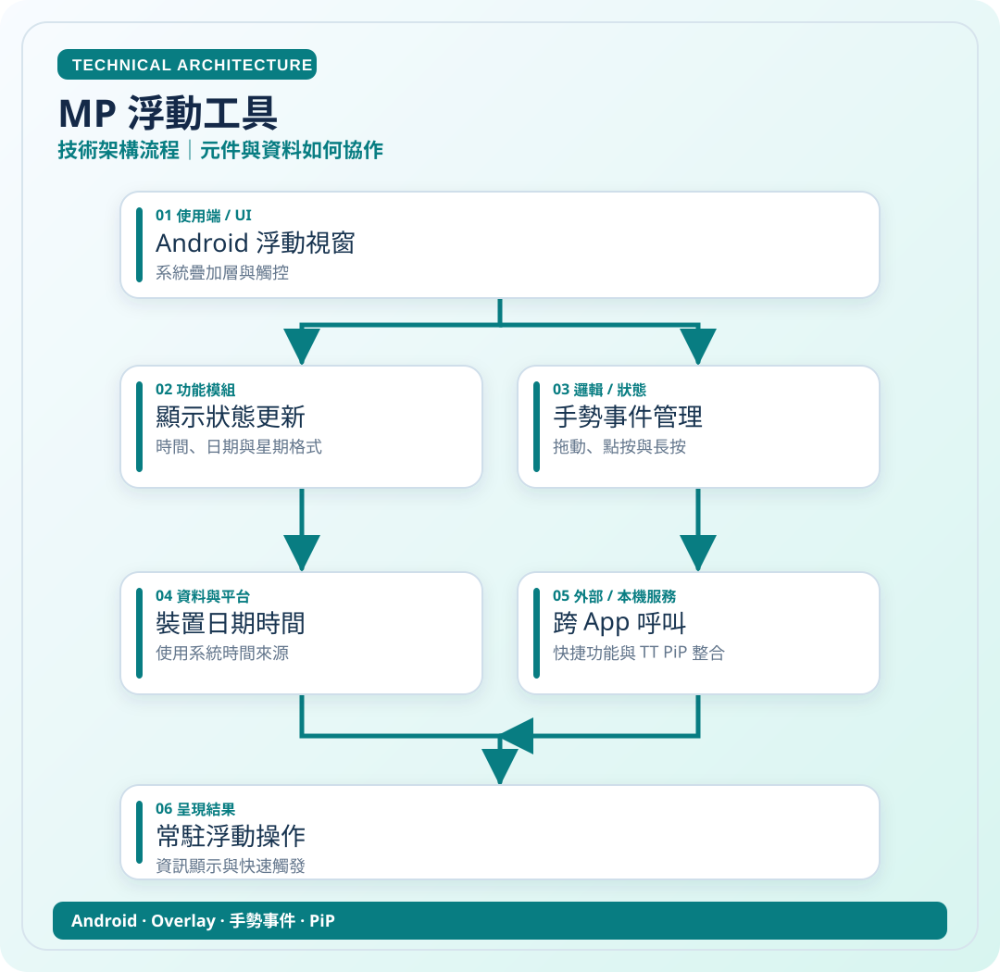

# MP 浮動工具

> 把時間資訊與常用快捷操作留在其他 App 畫面上。

**領域**：Android　｜　**專案狀態**：持續改善

[← 回作品集首頁](../README.md)　·　[開啟應用圖 SVG](../assets/diagrams/mp-app.svg)　·　[開啟技術圖 SVG](../assets/diagrams/mp-tech.svg)

## 01｜應用操作流程

從使用者角度，看一次主要操作如何完成。

## 02｜技術架構流程

從資料、模組與服務的角度理解專案。這是**高層次架構示意**，不是自動產生的完整程式碼呼叫圖。

### 使用或接觸的技術

- Android
- Overlay
- 手勢事件
- PiP

### 資料與驗證說明

依個人功能描述整理；Mp 儲存庫未提供可用 README。 圖中只呈現代表性流程，不等同所有功能已完成或通過實機驗收。

原始碼儲存庫 `ownkaika/Mp` 保持私人，不需公開給外部讀者。

---

[← 返回作品集目錄](../README.md)
