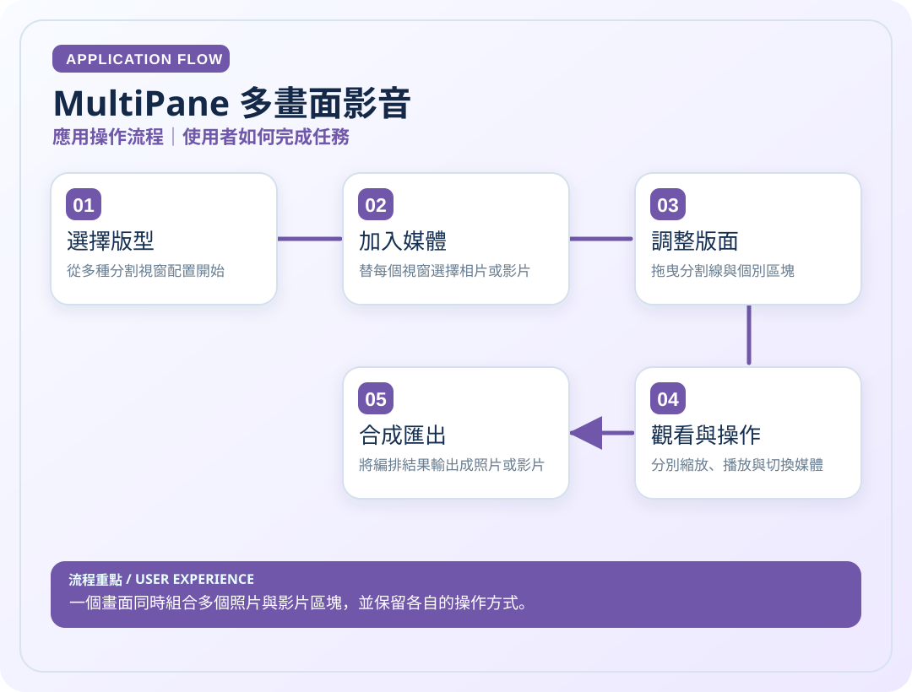
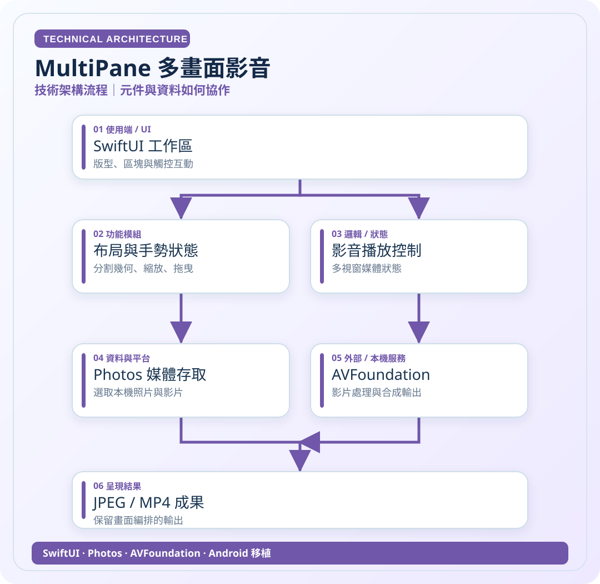

# MultiPane 多畫面影音

> 一個畫面同時組合多個照片與影片區塊，並保留各自的操作方式。

**領域**：iOS　｜　**專案狀態**：iOS 已使用／Android 移植

[← 回作品集首頁](../README.md)　·　[開啟應用圖 SVG](../assets/diagrams/multipane-app.svg)　·　[開啟技術圖 SVG](../assets/diagrams/multipane-tech.svg)

## 01｜應用操作流程

從使用者角度，看一次主要操作如何完成。

## 02｜技術架構流程

從資料、模組與服務的角度理解專案。這是**高層次架構示意**，不是自動產生的完整程式碼呼叫圖。

### 使用或接觸的技術

- SwiftUI
- Photos
- AVFoundation
- Android 移植

### 資料與驗證說明

依使用者 iOS 作品說明與 AP 移植 README 整理。 圖中只呈現代表性流程，不等同所有功能已完成或通過實機驗收。

原始碼儲存庫 `ownkaika/AP` 保持私人，不需公開給外部讀者。

---

[← 返回作品集目錄](../README.md)
