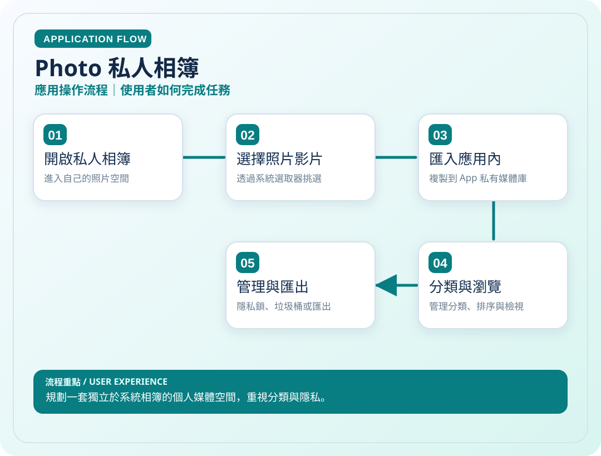
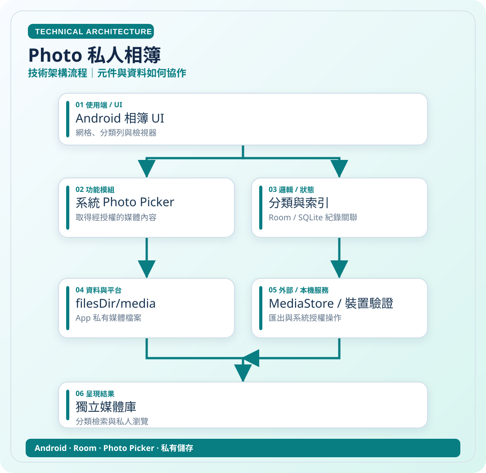

# Photo 私人相簿

> 規劃一套獨立於系統相簿的個人媒體空間，重視分類與隱私。

**領域**：Android　｜　**專案狀態**：開發與實機驗證中

[← 回作品集首頁](../README.md)

## 這是什麼作品？

Photo 是我為了單獨管理證件、作業、收據、照片和影片而設計的 Android 私人相簿。我希望這些影像不必全部混在三星系統相簿中，可以有自己的分類、排序與管理方式。

### 主要特色

從系統選擇照片或影片匯入 App 的私人媒體庫；管理分類與排序，規劃垃圾桶、匯出及可選的隱私鎖。部分功能仍在開發及驗證階段。

### 技術重點

Android Photo Picker、App 私有檔案儲存、分類索引、媒體權限及裝置驗證。

> **看圖提示**：下方應用圖與技術圖會直接顯示在本頁，無須開啟 SVG 檔案。

## 01｜應用操作流程

從使用者角度，看一次主要操作如何完成。

## 02｜技術架構流程

從資料、模組與服務的角度理解專案。這是**高層次架構示意**，不是自動產生的完整程式碼呼叫圖。

### 使用或接觸的技術

- Android
- Room
- Photo Picker
- 私有儲存

### 資料與驗證說明

依 Photo README 的首版實作與已知限制整理。 圖中只呈現代表性流程，不等同所有功能已完成或通過實機驗收。

原始碼儲存庫 `ownkaika/Photo` 保持私人，不需公開給外部讀者。

---

[← 返回作品集目錄](../README.md)
