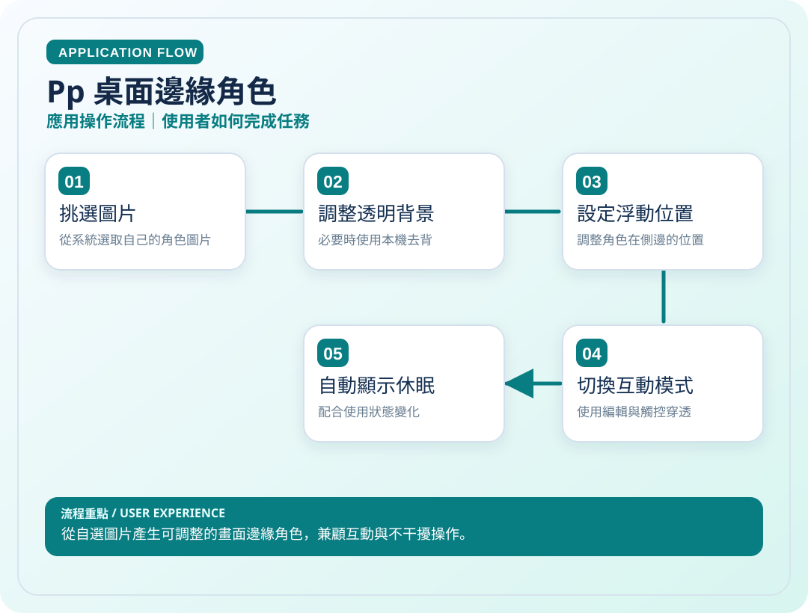
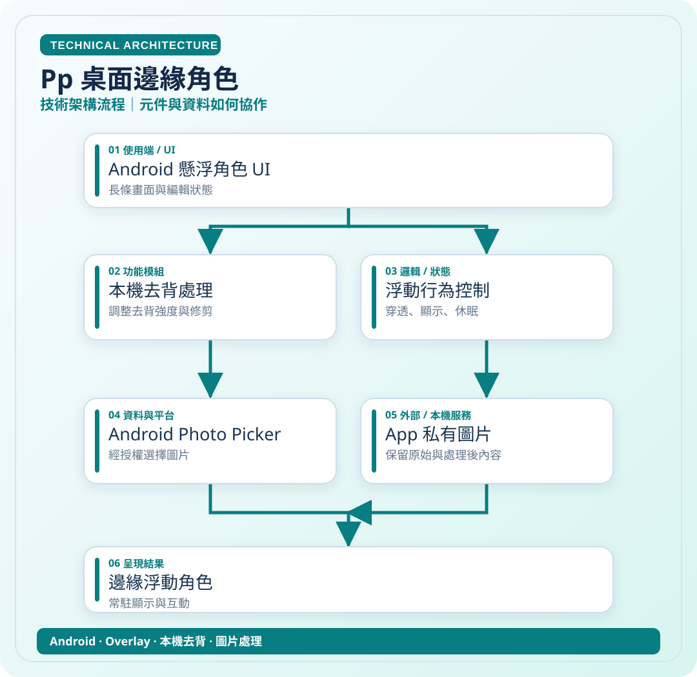

# Pp 桌面邊緣角色

> 從自選圖片產生可調整的畫面邊緣角色，兼顧互動與不干擾操作。

**領域**：Android　｜　**專案狀態**：個人化工具

[← 回作品集首頁](../README.md)

## 這是什麼作品？

Pp 是為喜歡把手機桌面個人化的人製作的 Android 邊緣角色工具。我希望能使用自己選擇的角色圖片裝飾畫面，但又不影響原本 App 的滑動與觸控。

### 主要特色與使用情境

自行選圖、本機去背、位置與大小調整、觸控穿透與狀態切換。

### 技術重點

Android Overlay、裝置端圖片處理、視窗位置與觸控事件管理。

> **看圖提示**：下方兩張圖已直接顯示在本頁，無須點開 SVG 原始碼。

## 01｜應用操作流程

從使用者角度，看一次主要操作如何完成。

## 02｜技術架構流程

從資料、模組與服務的角度理解專案。這是**高層次架構示意**，不是自動產生的完整程式碼呼叫圖。

### 使用或接觸的技術

- Android
- Overlay
- 本機去背
- 圖片處理

### 資料與驗證說明

依 Pp README 的本地去背與浮窗功能整理。 圖中只呈現代表性流程，不等同所有功能已完成或通過實機驗收。

原始碼儲存庫 `ownkaika/Pp` 保持私人，不需公開給外部讀者。

---

[← 返回作品集目錄](../README.md)
