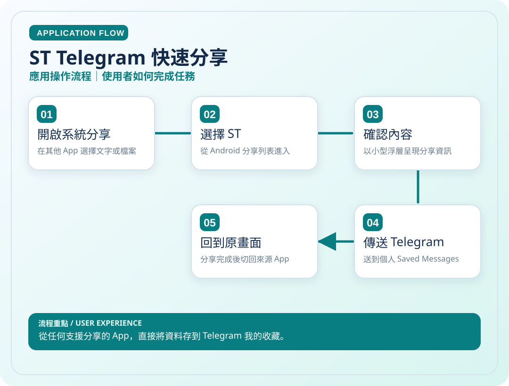
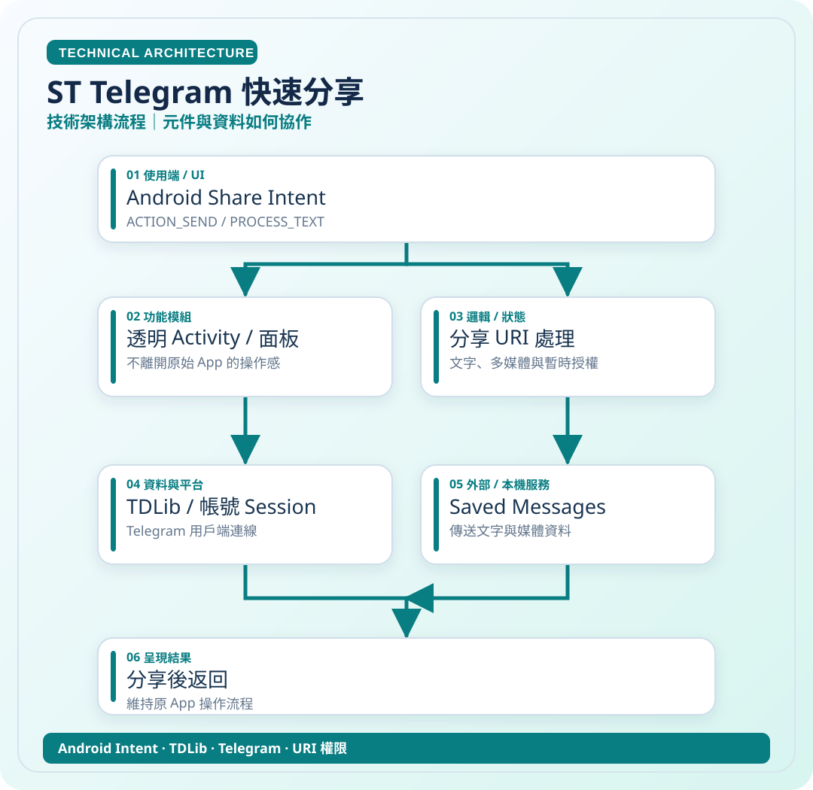

# ST Telegram 快速分享

> 從任何支援分享的 App，直接將資料存到 Telegram 我的收藏。

**領域**：Android　｜　**專案狀態**：開發作品

[← 回作品集首頁](../README.md)　·　[開啟應用圖 SVG](../assets/diagrams/st-app.svg)　·　[開啟技術圖 SVG](../assets/diagrams/st-tech.svg)

## 這是什麼作品？

ST 是我為了快速保存資料到 Telegram「我的收藏」而製作的 Android 分享工具。使用者在瀏覽器、相簿或其他 App 看到想留下的文字、網頁或圖片時，能直接使用系統分享選單，不用再開啟 Telegram 手動操作。

### 主要特色與使用對象

適合習慣利用 Telegram 收藏資訊的人；重點是 Android 分享選單、簡化傳送流程，以及處理文字和媒體內容。

### 技術重點

Android Intent、URI 權限、TDLib 與 Telegram 連線。下方兩張圖已嵌在此頁，可直接觀看。

## 01｜應用操作流程

從使用者角度，看一次主要操作如何完成。

## 02｜技術架構流程

從資料、模組與服務的角度理解專案。這是**高層次架構示意**，不是自動產生的完整程式碼呼叫圖。

### 使用或接觸的技術

- Android Intent
- TDLib
- Telegram
- URI 權限

### 資料與驗證說明

依 ST README 的 ACTION_SEND、TDLib 與分享操作整理。 圖中只呈現代表性流程，不等同所有功能已完成或通過實機驗收。

原始碼儲存庫 `ownkaika/ST` 保持私人，不需公開給外部讀者。

---

[← 返回作品集目錄](../README.md)
