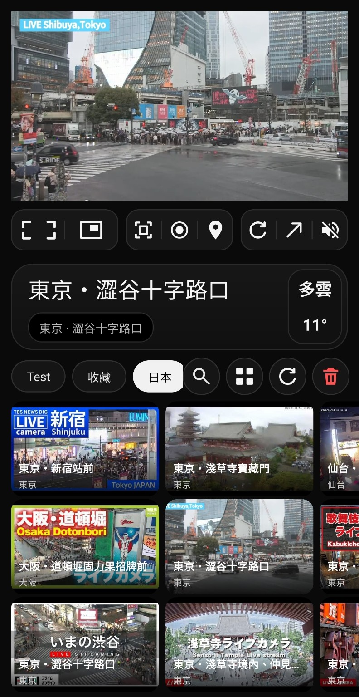
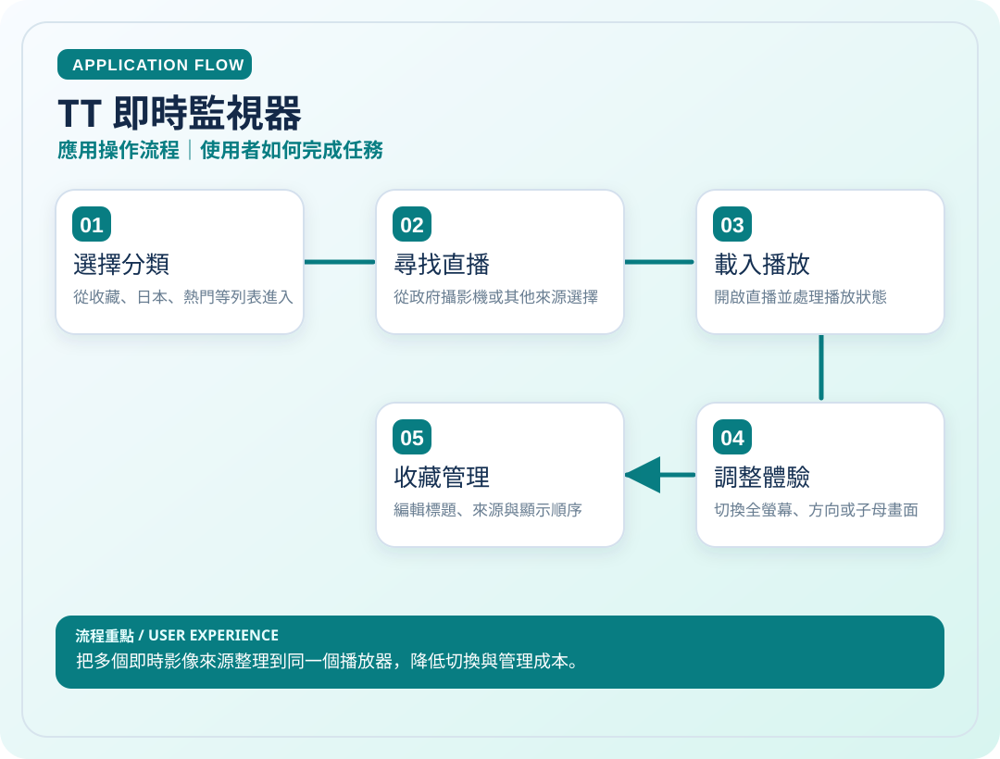
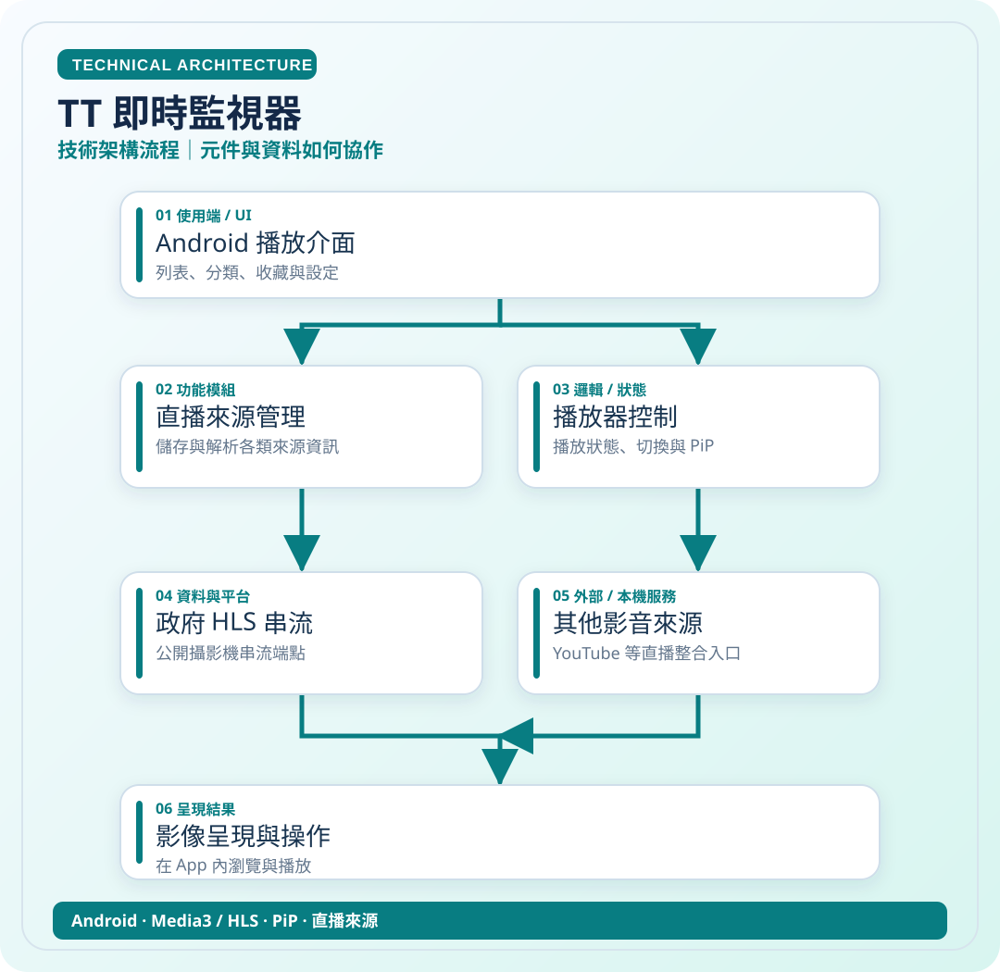

# 臺日公開即時影像 App｜Android

**類型：** Android App　　**性質：** 個人自主專案、持續改善

## 為什麼做

想看澀谷、新宿、淺草或臺灣的即時街景時，公開攝影機往往散落在不同網站與直播平台，需要不斷切換。我希望把常看的來源放在同一個地方，開啟 App 就能找到想看的畫面。

## 主要功能

- **依地區找影像**：整理臺灣、日本等公開攝影機與街景直播來源。
- **收藏與快速返回**：常看的地點不必每次重新搜尋。
- **集中播放**：在同一套播放器中觀看來源，並使用 Android 子母畫面（PiP）在其他 App 上繼續觀看。
- **來源與播放控制**：依實際操作整理列表、播放器按鈕及切換方式。

## 實際播放畫面

**畫面重點：** 上方直接播放**澀谷十字路口**直播；中間是播放器操作與地點資訊；下方可看到其他地區的即時影像，點選就能切換。

## 遇到的實際問題

不同來源的直播格式、連線狀態和播放限制並不一致。有的可以直接串流，有的需要另外處理；某個來源能播放，也不代表所有來源都能正常工作。因此我會在手機上實測，記錄播放中斷、畫面切換及子母畫面操作的問題，再逐步修正。

## 參與與技術

個人規劃分類、播放與收藏流程，並透過 AI 工具輔助程式開發與測試。接觸 Android、Media3／HLS、播放狀態管理與 PiP。

**目前狀態：** 主要操作持續調整；部分公開直播會因來源限制或格式變化而無法播放，並非由本專案控制所有攝影機或影像服務。

查看操作流程與技術架構示意

[回作品集首頁](../README.md)
